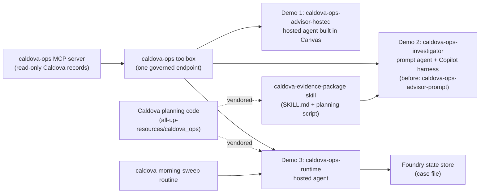

# Caldova: Build → Equip → Run

One agent's journey on [Microsoft Foundry](https://ai.azure.com): the same business problem solved three times, each time with just the amount of agent architecture the work needs. Each demo stands alone. The repo began as the demo material for three Microsoft Ignite 2026 lightning talks.

> Everything here uses **synthetic data** for a fictional company. No real suppliers, routes, operations or patient data.

## The scenario

**Caldova** makes medicines. A demand surge leaves its own **ALLER tablet** line about **1,500 units a week short for six weeks** (9,000 units in total). Three teams are affected: manufacturing needs capacity, supply chain needs to protect distribution, and procurement needs evidence it can defend.

Caldova wants an **operations agent** that compares supplier capacity, distribution routes, supplier risk and policy, then recommends a response with cited evidence. **People stay accountable:** the agent recommends, and it never books capacity, changes allocations or approves anything.

The three chapters ask three different questions about the same problem:

| Demo | Question | Agent | What it adds |
|---|---|---|---|
| [1 Build](demo1-build-canvas/README.md) | How quickly can I build this? | `caldova-ops-advisor-hosted`: a hosted agent built in Foundry Canvas | One prompt, the read-only `caldova-ops` toolbox, instructions and a guardrail; tested locally, then deployed |
| [2 Equip](demo2-equip-harness/README.md) | What does a prompt agent do badly, and what does the harness add? | `caldova-ops-advisor-prompt` (before), `caldova-ops-investigator` (after): a prompt agent with the Microsoft Copilot harness and a skill | Files in and out, a sandbox that runs Caldova's planning code, an independent review by subagents |
| [3 Run](demo3-run-hosted/README.md) | Who maintains the orchestration, and what does hosted do differently? | `caldova-ops-runtime`: a hosted Microsoft Agent Framework agent | A policy gate enforced in code, a case file that survives new conversations, a scheduled routine |

The thread: **complexity earns its way into the architecture.** Same Caldova records, same toolbox and same instructions; each chapter adds only what the work needs. Foundry Agent Service has two agent types, prompt agents and hosted agents, and the choice is **who maintains the agent's orchestration, Microsoft or you**. The Copilot harness (public preview) is an option within prompt agents; hosted agents are GA. It's a continuum, not a ladder: moving between them means creating a new agent.



## Try it offline (no Azure needed)

```bash
python -m unittest discover -s all-up-resources/tests

# Build the evidence package exactly as the harness skill does in its sandbox
python demo2-equip-harness/agents/caldova-ops-investigator/skills/caldova-evidence-package/scripts/build_evidence_package.py \
  --bundle demo2-equip-harness/golden/evidence/bundle.json \
  --demand all-up-resources/inputs/aller-demand-plan.csv --out /tmp/caldova-out
```

## Deploy to your own Foundry project

You need a Foundry project, `azd`, and (for demo 1) GitHub Copilot with the Foundry Canvas plugin. Follow [SETUP.md](SETUP.md). Several features used here (the Copilot harness, the Foundry state store, toolboxes, routines) are in preview, so names and behaviour may change; SETUP.md lists known gotchas.

## What's here

```
SETUP.md                       prerequisites, deploy steps, smoke tests, known gotchas, cleanup
all-up-resources/              shared code, MCP server, tooling and tests used by all three demos
  caldova_ops/                 canonical evidence register + deterministic planning and policy gate (stdlib only)
  caldova-ops-mcp/             the MCP server behind the toolbox, with deploy.sh for Container Apps
  ask.py                       one caller for all three agents, by name
  grant_agent_identity.sh      gives an agent identity Foundry User on the project
  sync_shared.py               copies caldova_ops into the MCP server, skill and hosted agents
  link_azd_env.sh              copies the azd environment into each agent folder
  tests/                       61 offline tests
demo1-build-canvas/            walkthrough, Canvas prompt and instructions, the hosted agent source
demo2-equip-harness/           walkthrough, the skill, golden evidence package
demo3-run-hosted/              walkthrough, Agent Framework source, web UI
```

`caldova_ops` is deliberately copied into each deployable (MCP server, skill, hosted agents) so each one deploys on its own. Edit `all-up-resources/caldova_ops/` and run `python all-up-resources/sync_shared.py` to refresh the copies.

## The scenario data

All records are synthetic training fixtures; no real suppliers, routes, operations or patient data.

| Source | Says | From |
|---|---|---|
| DISRUPT-001 | 1,500 units a week short for 6 weeks (9,000 total); week-by-week in the demand file | New for these demos |
| CAP-001, CAP-POLICY | Aster Ridge 1,200 a week, qualified; Northbank 1,800, qualification pending; capacity isn't authorization | Synthetic fixture |
| DIST-001, DIST-POLICY | Cedar 2-day, cap 600; Birch 4-day, cap 1,000; Elm unassessed; allocation changes need Distribution Lead and Quality | Synthetic fixture |
| RISK-001, RISK-POLICY | Northbank: 2 overdue corrective actions, unresolved qualification → elevated risk | Synthetic fixture |
| PACKET-001, PACKET-POLICY | CP-104 (switch to Northbank) is missing four items, each with an owner | Synthetic fixture |
| CONTRACT-AR-001 | Aster Ridge SOW covers compression, coating, inspection, bottle packaging; blister packs need written authorization | Caldova supplier story |

The demand file's weekly gaps (1,100 / 1,400 / 1,800 / 1,700 / 1,500 / 1,500) average the brief's 1,500, so demo 1's answer and demo 2's exact plan agree.

## Verification

Verified offline by the test suite: the planning engine and policy gate, data and prose consistency, evidence-bundle tamper detection, the skill script end to end (its output is `demo2-equip-harness/golden/`), the MCP tools and key check, the hosted agent's case stores, and `main.py` wiring against stub Agent Framework modules. Deployed behaviour (model calls, Canvas, the Foundry state store) needs your own project; see SETUP.md.

## License

[MIT](LICENSE)
